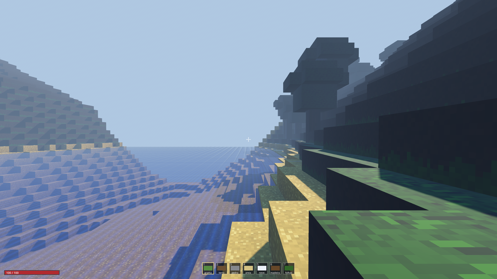
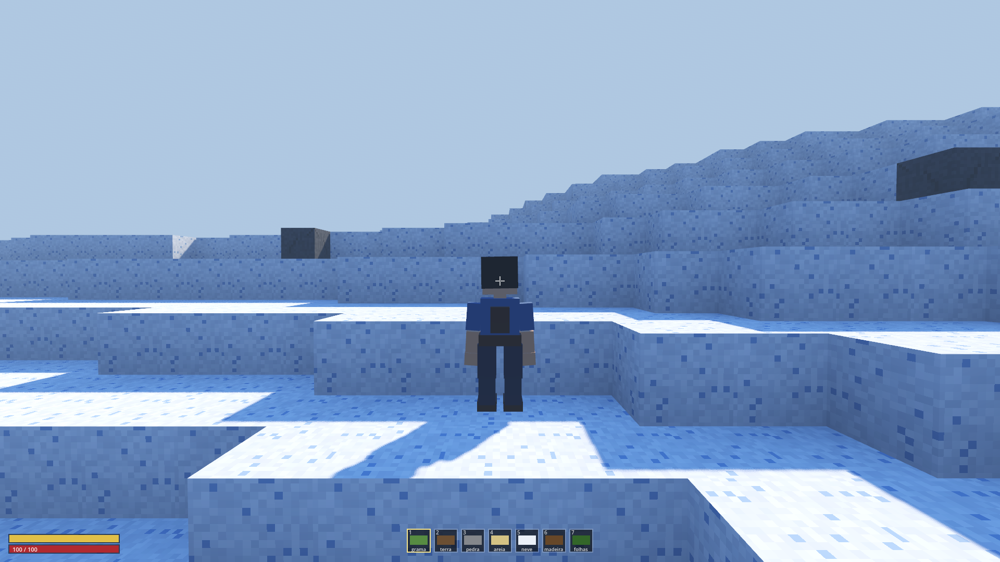
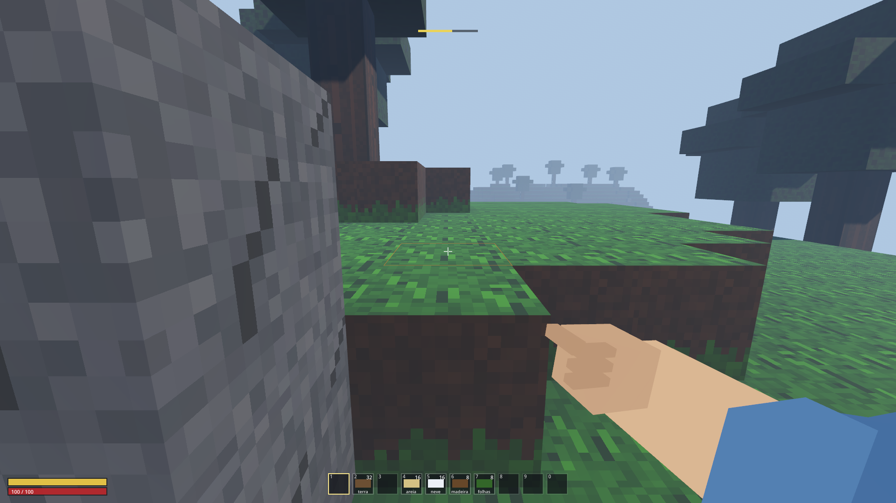
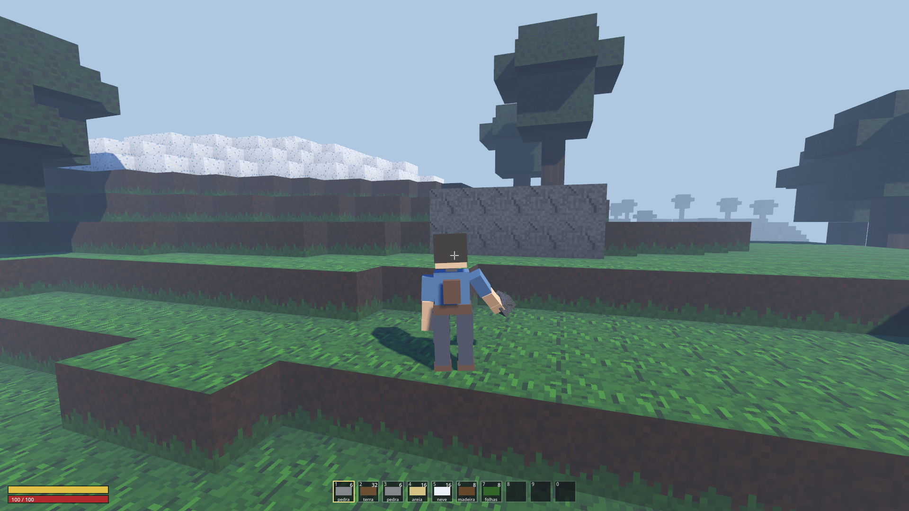
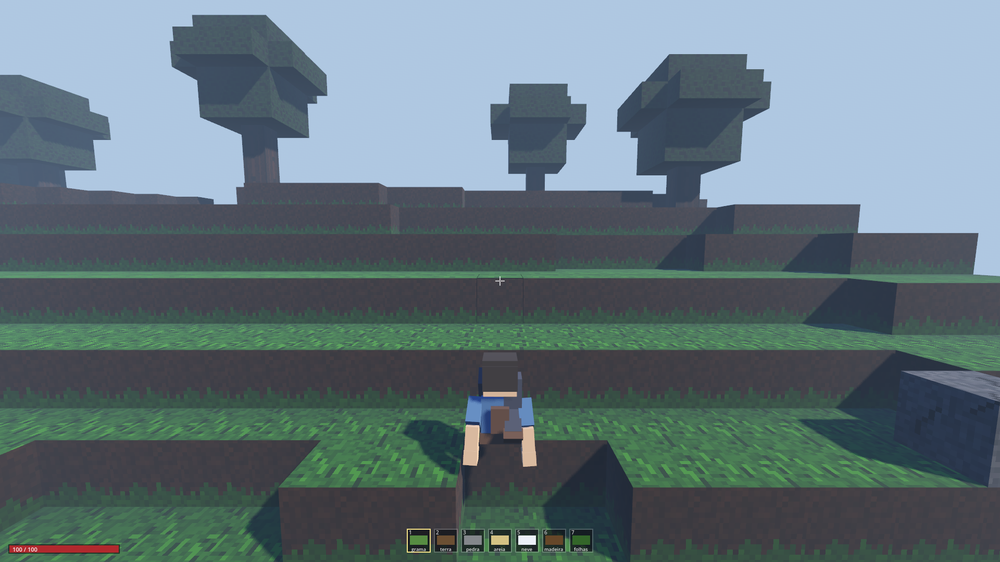
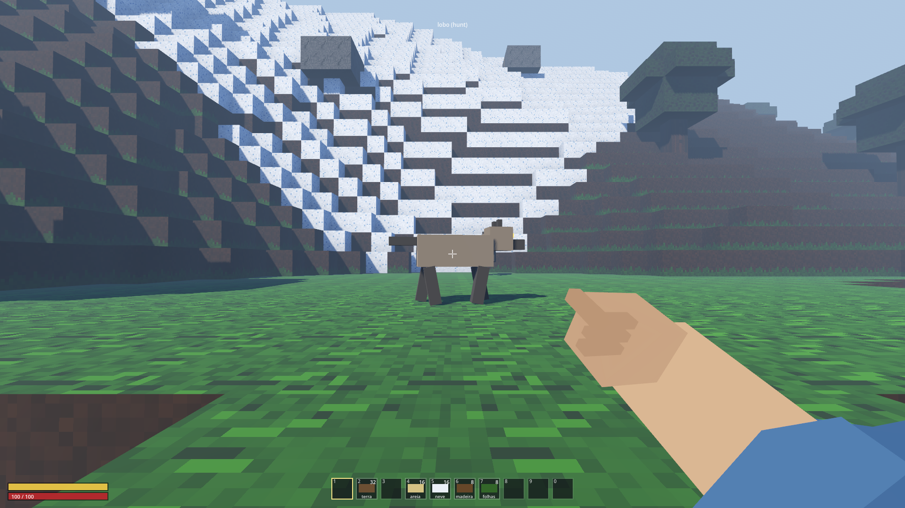
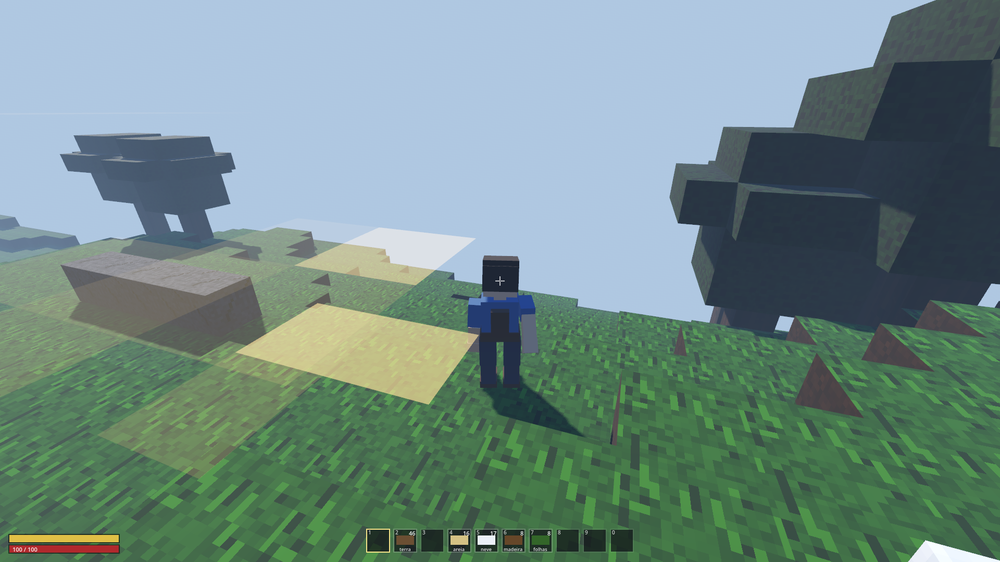

# Aetherfall

RPG open-world em voxels, feito em **Godot 4.7** com **GDScript**, sob licença
**MIT**. O diferencial do projeto é a IA dos moradores do mundo rodar 100% na
máquina do jogador: comportamento de criaturas, personalidade e memória de NPCs,
facções e eventos nascem de simulação local, sem serviço de nuvem.

Este repositório contém o **slice P0/P1**: um mundo procedural jogável em 3D,
com mecânicas de quebra/colocação, combate, memória do mundo (campo de Éter) e
lobos guiados por Behavior Tree + Utilidade + memória. O design completo do jogo
está em [`docs/design/`](docs/design/).

## O mundo

Todos os frames abaixo saíram do próprio RenderingServer do jogo rodando em
janela, 1920×1080, na seed padrão `20261116` — sem captura de desktop, sem
mockup, sem render de outra engine.

<table>
  <tr>
    <td width="50%"></td>
    <td width="50%"></td>
  </tr>
  <tr>
    <th>Planície, 3ª pessoa — o bloco na mão direita muda o porte do braço</th>
    <th>Planície, 1ª pessoa</th>
  </tr>
  <tr>
    <td></td>
    <td></td>
  </tr>
  <tr>
    <th>Orla de mata — o dossel a poucos blocos</th>
    <th>Lago e praia de areia no <code>SEA_LEVEL 26</code></th>
  </tr>
  <tr>
    <td></td>
    <td></td>
  </tr>
  <tr>
    <th>Monte nevado, 3ª pessoa</th>
    <th>Mirante: a neve descendo até o vale</th>
  </tr>
  <tr>
    <td></td>
    <td></td>
  </tr>
  <tr>
    <th>Minerando — a barra é progresso real, só existe lavrando</th>
    <th>Construção — muro 5×2 de pedra, bloco por bloco pelo clique direito</th>
  </tr>
  <tr>
    <td></td>
    <td></td>
  </tr>
  <tr>
    <th>Salto no ápice — 1,33 m de elevação medida</th>
    <th>Lobo sob a mira, com a intenção da mente no rótulo do alvo</th>
  </tr>
  <tr>
    <td colspan="2"></td>
  </tr>
  <tr>
    <th colspan="2">Visão do Éter (<code>B</code>) — o mapa de calor da memória do mundo; aqui o canal de trabalho, aceso por lavrar blocos. Sangue e medo entram quando um lobo faz parte da cena</th>
  </tr>
</table>

## Rodando em 1 clique (Windows)

Dois toques em **`Rodar.bat`**, na raiz do clone. Ele faz, nesta ordem:

1. **acha o Godot 4.7.2** — primeiro em `.tools/` (o pin do projeto), depois no
   `PATH`. Um 4.7.x do PATH serve; outra versão é listada e ignorada, porque o
   `project.godot` declara `config/features = "4.7"`.
2. **baixa o motor se não houver** — o build portátil oficial para dentro de
   `.tools/`, conferindo tamanho e digest antes de extrair:
   86.013.866 bytes e sha256
   `731980f9608d61333e5baf54a2ef17210acc7a538446c0cb9969f002aca1e953`
   (os dois números publicados pela API de releases do repositório oficial do
   Godot, batidos com o zip já instalado nesta máquina). Download truncado é
   descartado, não vira engine.
3. **roda o `--import`** se faltar `.godot/global_script_class_cache.cfg` — o
   passo existe por um motivo, veja abaixo.
4. **abre o jogo.** Se o processo morrer nos primeiros 6 s, o launcher reabre
   pelo build de console para o erro aparecer na tela em vez de a janela
   simplesmente sumir; se ele sobrevive, a janela preta do launcher fecha e a
   partida segue sozinha.

Os três primeiros passos foram exercidos de ponta a ponta num clone limpo deste
repositório, com `.tools/` vazio: o download de 86.013.866 bytes, o digest
conferido, o import montando o cache de classes e o `-CheckOnly` devolvendo 0. A
recusa do passo 4 com uma janela já aberta também é medida — código 2, sem nada
lançado.

Não compila nada: o "executável" do jogo é o projeto GDScript mais a engine
portável. Não há `npm install` da vida, e atlas e texturas são desenhados em
runtime — os PNG de `docs/media/` são capturas de tela, não assets do jogo.
`models/` e `.tools/` estão no `.gitignore`, e o jogo roda sem eles (o oráculo
de IA local é opcional).

O mesmo script atende outras entradas:

| Entrada | O que faz |
|---|---|
| `Rodar.bat -CheckOnly` | mostra o motor resolvido, as instâncias abertas e o comando final, sem abrir nada |
| `Rodar.bat -Editor` | abre o editor em vez do jogo |
| `Rodar.bat -Tests` | roda a suíte headless inteira (`tests/smoke_test.tscn`) |
| `Rodar.bat -Engine "D:\Godot\Godot_v4.7.2-stable_win64.exe"` | usa o motor que você já tem, fora do PATH |
| `Rodar.bat -Force` | abre mesmo com outra janela do mesmo save aberta |

A última linha existe por um motivo concreto: duas janelas abertas escrevem no
mesmo save (`user://saves/world_alpha.json`) e a última gravação vence — então o
segundo clique é recusado por padrão, com a lista dos PIDs e das linhas de
comando abertos. Quem conta como a mesma janela não é decidido pelo binário nem
pela pasta: `user://` sai de `application/config/name` do `project.godot`, então
um segundo clone do repo cai na mesma checagem. Ficam fora da conta a suíte
(`--headless`), o editor parado e o gerenciador de projetos; uma janela do jogo
só não é vista quando o motor veio de fora e rodou com `--path` relativo, porque
aí a linha de comando não diz o projeto. `tools/run_game.ps1` é o script por trás do `.bat` (rodar ele direto
do PowerShell faz o mesmo); o `.bat` só existe para caber em dois toques e para
chegar em CRLF, que o `cmd.exe` exige. Em Linux/macOS, o caminho é o da seção
abaixo.

## Rodando pela linha de comando

Pré-requisito único: **Godot 4.7** (o padrão serve; não há C#, não há addons, não
há assets para baixar). As medições deste README foram feitas no
**4.7.2-stable** com Vulkan Forward+. Renderiza em qualquer GPU com Vulkan 1.0.

```sh
git clone https://github.com/DouglasGDev/aetherfall.git
cd aetherfall
godot --headless --path . --import   # UMA VEZ: monta o .godot/ e o cache de classes
godot --path .                       # Linux/macOS
# Windows: .\Godot_v4.7.2-stable_win64.exe --path .
# Windows com 1 clique: .\Rodar.bat
```

Esse `--import` não é burocracia: acabado de clonar, o projeto não tem `.godot/`
e por isso não tem o registro dos `class_name`. Pular a linha faz o run abrir
com `Could not find type "VoxelWorld" in the current scope` em tudo que depende
de `src/world/` — reproduzido aqui num clone limpo, e some depois do import. Se
você abrir o `project.godot` no editor em vez de usar a linha de comando, o
próprio editor faz o import e o passo acima é desnecessário.

Ou, pelo editor: **Importar** → selecionar `project.godot` → **F5**.

O primeiro boot gera o mundo e malha os 64 chunks antes de entregar o controle ao
jogador: ~0,9 s de geração e ~4,3 s de malharia nesta máquina (medido; veja
*Limites*). O save vai para `user://saves/world_alpha.json` — no Windows,
`%APPDATA%\Godot\app_userdata\Aetherfall\saves\`. `F5` salva, `F9` carrega.

Um save antigo é recusado de propósito quando o gerador muda (`GEN_VERSION`): a
mensagem manda recriar o mundo em vez de interpretar mal o relevo.

## Controles

| Tecla | Ação |
| --- | --- |
| `W` `A` `S` `D` | mover |
| `Espaço` | pular |
| `Shift` | correr (consome vigor) |
| `Ctrl` | agachar / planar segurando no ar |
| Botão esquerdo | minerar bloco / atacar criatura |
| Botão do meio | rolamento (invencibilidade breve, custa vigor) |
| Botão direito | colocar bloco da pilha selecionada (gasta 1) |
| `1`–`9`, `0` | pino da hotbar: as dez teclas apontam para slots do inventário |
| `I` | inventário e receitas (por dentro: `WASD`/setas movem o cursor, `E` pega/solta, `Q` parte a pilha ao meio, `1`–`9`/`0` repinam a célula, `Tab` troca de receita, `Enter` crafta) |
| `V` | câmera em 1ª / 3ª pessoa |
| `B` | visão do Éter (mapa de calor dos canais) |
| `F3` | HUD de debug |
| `F2` | lista de bindagens |
| `F5` / `F9` | salvar / carregar o slot `alpha` |
| `Esc` | liberar o cursor |
| `R` | renascer (só com o jogador morto) |

## Teste headless

A suíte roda a sessão real (`src/main.tscn`) sem janela e só conta como prova o
que foi medido naquela execução. Ela sobrescreve o slot `alpha`: use uma cópia de teste
com diretório de dados isolado, conforme as [notas de medição](docs/melhorias-status.md#notas-de-medição):

```sh
godot --headless --path . --import            # só no clone ainda não importado
godot --headless --path . tests/smoke_test.tscn
```

Sai com código `1` se qualquer checagem falhar. O número da rodada do bioma é da revisão `44c9d94`, ponta de
`feat/bioma-e-cor-de-pelo-09` sobre a base `e7e30e6`, medida num clone limpo dela mesma (os 79 arquivos de
[docs/evidence/bioma-cor-de-pelo/sources.sha256](docs/evidence/bioma-cor-de-pelo/sources.sha256), sem
`.godot/`, sem `.tools/` e sem `override.cfg`), recém-importado com o `--import` logo acima:
**237 checagens, 0 falhas, 35,5 s**, exit 0 — as mesmas 237 linhas de checagem da corrida feita na árvore
de trabalho desta vez; o `diff` dos dois logs conta 14 linhas e **nenhuma é checagem**: sete pares de
número de tempo (geração e malharia, `pior passo` duas vezes, determinismo, cronômetro do passo, leitura
do slot) e o diagnóstico final, onde só `gen_ms` (946,922 → 958,011), `mesh_ms` (4 523,613 → 4 542,158) e
`worst_sim_ms` (10,027 → 9,754) se movem. O estado final confere dígito a dígito nos dois logs
(`aether_energy` `9,44745890423656`, 4 lobos vivos, `tick=359`, `dropped_ticks=0`, `triangles=214480`,
`chunks=64`, `edits=13`). O vazamento do quit, que entrou junto com o som (medido e explicado em "O jogo
tem som, e o som não manda no mundo"), sai **igual nos dois** nesta revisão — `WARNING: 8 ObjectDB
instances were leaked at exit` na linha 313 e `ERROR: 4 resources still in use at exit` na linha 315 — e é
o mesmo par de `merge-ff347d2-suite.log` e `main-suite.log` da rodada anterior, onde só o
`branch-suite.log` deu `4` / `2`; nenhum dos doze runners desta pasta imprime qualquer dos dois.
A atribuição do par segue aberta, como na rodada de
rastros, e o registro desta revisão está em
[docs/evidence/bioma-cor-de-pelo/readback.md](docs/evidence/bioma-cor-de-pelo/readback.md).
Que "clone limpo da mesma revisão" não é generosidade de redação é conferido por hash de árvore:
`git rev-parse 44c9d94:src 44c9d94:tests` devolve `9f3a952dc123…` / `56e487343728…`, e `git diff
--name-only e7e30e6 44c9d94` conta exatamente os cinco arquivos da perna — `src/world/world_gen.gd`,
`src/entities/wolf.gd`, `src/main.gd`, `tests/smoke_test.gd` e `tests/aether_reactions_test.gd`.
A suíte re-rodou na `main` mergida (`9fe5e45`), e ela devolve os mesmos dois hashes de `src` e `tests`:
o que a merge acrescentou são 20 arquivos de `README.md` e `docs/`, e a última linha continua
`237 checagens 0 falhas`, exit 0, com zero `SCRIPT ERROR`.

**O pin de hoje é `5b519f8`**, a `main` do merge `--no-ff` do fecho da perna 11 (acasalamento,
filhote e censo variável), que é o merge do fecho `docs/fecho-acasalamento-censo-11` sobre
`4b858c2`, o merge `--no-ff` da branch `feat/acasalamento-e-censo-11` (ponta de código `0762b43`)
sobre a base `e7a5fe7`. A árvore de código do pin **mudou** em `src` e `tests` de novo: `git
rev-parse 5b519f8:src 5b519f8:tests` devolve `30873d664a9577bcd3e709046cc708923456c372` e
`975eac5a471dc1e064441474ef6e13866076d34f` — e `4b858c2:src` e `4b858c2:tests` devolvem os mesmos
dois objetos, porque o fecho trouxe `.md` e `.log` e nenhum `.gd`. A perna 11 escreve em
`src/entities/wolf.gd`, `src/main.gd`, `src/ai/mind_oracle.gd` e nos dois runners. O número do pin
é a corrida arquivada dessa árvore: **252 checagens, 0 falhas, 42,9 s**, exit 0, zero `SCRIPT
ERROR` nas duas correntes, `dropped_ticks` **0**, `births` **2**, `census_cap` **12**, `wolves` **7**
e `worst_sim_ms` **13,684** dos 50 ms do passo — medidos no clone limpo de `4b858c2`, sem
`.godot/` e com `--import` frio exit 0; a `main` do fecho re-rodada deu **252 / 0 / 43,0 s**, e o
runner de reações deu **225 / 0 / 15,451 s** no clone, **225 / 0 / 15,348 s** na `main` do fecho
e **225 / 0 / 15,343 s** na branch. Esse `worst_sim_ms` é uma corrida, não uma faixa. Logs,
`artifacts.sha256` e a conferência do clone estão em [readback.md](docs/evidence/acasalamento-censo-11/readback.md).
O par de vazamento do quit sai na **primeira** corrida do clone (stderr de 249 bytes) e **não** sai
na segunda, no mesmo clone e com o mesmo comando; com `--verbose` o objeto é nomeado — é a
ambiência `res://assets/audio/amb/amb_birds.ogg` viva no instante em que o processo morre —, e o
braço de controle na `main` **sem** esta perna dá o mesmo par, maior (**16 ObjectDB com 6
resources**): ele **precede** a perna 11 e não é dela. O pin anterior, `ab9ffa1` (perna 19), tinha
`45efe977f74de…` e `37eb429c142d…` e deu **246 / 0 / 39,6 s** no clone limpo; o registro completo
está em [readback.md](docs/evidence/auto-pulo-19/readback.md).
Na revisão histórica `9c6b722` foram quatro corridas seguidas nesta máquina: **220 checagens,
0 falhas, 35,6 / 35,9 / 36,3 / 36,4 s** — e num clone limpo de `9c6b722`
(29 `.gd`, sem `.godot/`): **220 checagens, 0 falhas, 35,4 s**. Essas cinco não têm nenhuma
linha `ERROR` do engine. A contagem é sempre da revisão medida, nunca do texto: a
rodada de inventário, pilhas e craft acrescentou passos (`inventario, pilhas e
receitas` e as checagens de quantidade dentro de `minerar e colocar`,
`colocar com clique`, `tecla 3 no hotbar`, `malha e face-culling` (os dois panos
de vidro e o censo de material por surface), `hud, morte e renascer` e
`salvar e carregar`), a rodada de corpo acrescentou `corpo encaixado se solta`
e o gate de `steering e colisao movem o lobo`, a rodada do view model de 1ª
pessoa são as 11 checagens a mais sobre as 208 de antes: o censo das duas vistas
(23 caixas em 3ª, 10 no braço em 1ª, cada uma fora da outra), a calibração da
projeção contra `unproject_position` e o enquadramento dos dois arcos. A de hoje
é a premissa do passo de golpe (`mira travada no lobo do passo`, a 12ª sobre as
208): o lobo que recebe o dano tem que ser o que está na mira, senão a matilha
inteira ainda viva pode roubar o golpe no meio dos 280 ticks de janela. Sobre as
220 entram as 12 checagens do porte em 3ª pessoa: o cubo na mão do avatar é o
slot selecionado, fica acima do joelho e abaixo da cabeça, na lateral direita à
frente do tronco, amostra o atlas do mundo no tamanho da órbita, o vidro usa o
material alpha, pilha zerada equivale a mão vazia, o peso do bloco muda a pose do
braço, o golpe com pedra afunda mais que sem carga, o ciclo de lavra do rig mexe o
ombro, pedra lavra mais funda e mais lenta que folha, a mão vazia devolve o braço
ao repouso e a fração da face do cubo que sai do braço no quadro da órbita.

**A perna 16 (tocas da alcateia) ainda não pousou**: os números dela são da ponta de
`feat/tocas-da-alcateia-16` medida nesta árvore de trabalho, e o pin acima não os inclui. A suíte
dá **255 checagens, 0 falhas, 48,0 s**, exit 0, linha 357 de
[head_suite.log](docs/evidence/tocas-alcateia-16/head_suite.log), que traz as duas correntes e não
tem nenhum `SCRIPT ERROR`; o estado final confere `dropped_ticks` **0**, `tick=403`, `worst_sim_ms`
**10,766** dos 50 ms do passo, `dens` **3**, `den_components` **3**, `den_min_dist` **55,9 m**
contra a régua de 48 m, `pack_pairs` **21**, `wolves` **7**, `births` **2**, `census_cap` **12**,
`edits=13` e `triangles=214480`. São três checagens a mais sobre as 252 do pin e **nenhuma a
menos**: o `diff` de rótulos entre o `merged_main_suite.log` daquela corrida e este devolve
exatamente `espalhamento_nao_estoura_o_passo`, `tocas e pertenca sobrevivem ao save` e
`default derivado: disco sem a chave nao toca nem inventa dens`. O runner de reações sobe de 225
para **240 / 0** (`head_runner_run1.log:494`, 24,586 s; segunda corrida 24,446 s) e o custo pareado
contra a base `99d1167` — mesma suíte, mesma semente, quatro corridas, máquina livre — sai
**−0,70 %** no cenário estreito e **−0,76 %** nos passos de matilha, ambos dentro do espalhamento
de repetir o próprio braço: nenhuma diferença mensurável, com a conta e o vínculo de revisão em
[custo-pareado.md](docs/evidence/tocas-alcateia-16/custo-pareado.md). O par de vazamento do quit
sai na corrida arquivada — `4 ObjectDB` (linha 358) com `2 resources still in use` (linha 360), o
mesmo par do pin — e **não** sai na re-corrida desta mesma árvore, feita para fechar a doc
(**255 / 0 / 47,7 s**, exit 0, linha 357 de
[docs_rerun_suite.log](docs/evidence/tocas-alcateia-16/docs_rerun_suite.log)): é o comportamento já
registrado no clone da perna 11, e a
atribuição continua aberta e fora desta perna.

O que a suíte cobre:

- geração determinística (16 colunas de relevo e malha idênticas entre dois
  mundos criados com a mesma seed), face-culling exato (cubo 3×3×3 soma
  exatamente 108 triângulos; sem culling seriam 324) e winding dos triângulos
  na convenção de face frontal do Godot — com o índice em (0,1,2) o
  rasterizador descartava todas as faces de topo e o terreno aparecia
  transparente;
- relógio de simulação: 60 Hz de locomoção contra 20 Hz de lógica, teto de 5
  passos por frame, nenhum tick perdido durante o teste inteiro;
- corpo contra terreno: o ponto de nascimento do lobo só é aceito com o volume
  do corpo livre (o AABB de 1,35 m de profundidade nasce dentro da parede do
  degrau vizinho e, encaixado, nenhum eixo anda — medido em 2 dos 5 lobos), e o
  integrador resgata corpo encaixado subindo até a primeira altura em que ele
  cabe (1,0 m medido, teto de 1,2 m, sem teleporte); o gate de movimento do
  lobo monta a situação num ponto livre e dá ele mesmo os 200 passos de 0,05 s,
  em vez de contar lobos numa janela de relógio de parede — que era sorte: a
  mesma contagem já saiu 1/5, 2/5 e 3/5;
- mecânicas: mineração com o tempo igual à dureza do bloco, colocação por
  clique real do mouse passando pelo InputMap, recusa de colocar dentro do
  próprio corpo, construção com o botão esquerdo ainda pressionado (lavar um
  bloco não engole o clique direito), troca de hotbar por tecla;
- inventário com quantidade: 36 slots de pilha por bloco, teto lido do registro
  (64 para bloco comum, 16 para bancada), coleta enchendo toda pilha parcial
  antes do primeiro buraco, `take` de trás para frente, partir por divisão
  inteira, mesclar-ou-trocar ao pegar/soltar, e o portão de espaço antes de o
  bloco sair do mundo; craft por lista com estação por distância (5,0 m) e o
  preço cobrado nos dois lados — a receita que não tem onde guardar a saída não
  consome nada;
- mecânicas do Veloren adaptadas: golpe com dano fixo que atordoa (steering
  suspenso) e empurra o lobo, vigor que a corrida drena e parar recupera com
  trava por histerese, rolamento no botão do meio com janela de invencibilidade
  de 0,45 s, planar segurando `Ctrl` no ar (mergulhar o olhar ganha velocidade,
  cap de queda medido no próprio ângulo), queda livre que machuca acima da
  velocidade segura, respiração com afogamento por período e regeneração fora
  de combate;
- IA local opcional (oráculo): com a porta do llama-server fechada, o pedido
  estoura o timeout, o oráculo entra em recuo (30 s medidos) e a narrativa no
  debug fica vazia — utilidade e árvore seguem decidindo sozinhas;
- sistema de coordenadas canônico (`Coords`): piso de negativos, bordas de
  chunk (15/16), ida e volta origem+local, chave de save com negativo e a grade
  grossa do Éter (4×4×4) saem todos do mesmo módulo;
- corpo do jogador: um modelo por vista. Em 3ª pessoa, 23 caixas montadas em
  pivôs, coladas nos pés, girando com o yaw, todas em cena e com o braço direito de
  porte conforme o bloco segurado (ver "Porte na 3ª pessoa"); em 1ª pessoa o rig
  sai inteiro e entra o view model — 10 caixas de ombro, manga, antebraço, punho
  e dedos desenhadas para a lente, segurando o bloco do slot selecionado (pilha
  zerada devolve punho fechado). O cubo na mão é medido em pixels do quadro
  1280×720: dentro do quadro e no quadrante inferior direito, com a mira livre,
  tanto em repouso quanto nos dois arcos (golpe de 24 ticks, lavra de 60), e o
  membro desenha sem teste de profundidade para não ser engolido pela parede
  encostada no nariz. A projeção usada por essas checagens é calibrada contra o
  `unproject_position` do motor na resolução do próprio processo (0,0005 px de
  desvio), porque o viewport headless é 64×64 e mentiria sobre o enquadramento;
- IA: a mesma memória (`Mind`) muda a decisão do lobo entre os braços com e sem
  episódios gravados, e a fuga aparece depois de levar dano;
- campo de Éter: imprint, difusão para a célula vizinha e meia-vida por canal;
- HUD, morte e renascer, ciclo de vida dos lobos (cadáver, recolhimento e
  reposição de matilha);
- matilha em tocas (dossie 16): 3 tocas fundadas no boot, cada uma um componente
  conexo do grafo de coesão e nenhum lobo lendo de outra toca
  (`arestas_entre_tocas=0`), separação mínima de 55,9 m contra a régua de 48 m
  (`DEN_MIN_DIST`), a recusa de spawn contada por motivo — `soma(motivos)` igual
  a buscas × `SPAWN_ATTEMPTS` — e o passo de 20 Hz do espalhamento dentro da
  régua de 25 ms (pior passo 10,77 ms dos 50 de orçamento, `dropped_ticks` 0);
- persistência: salvar → mutar o mundo → carregar devolve relevo, diário de
  edições, posição, vida, tick e a memória dos lobos, agora com a toca de cada
  um e o `den` do disco conferidos identidade a identidade.

## Bloco na mão

O item opaco desenha após os dedos, sem a pele atravessar a face do bloco; vidro continua
transparente. A correção passou em 21 checagens com renderização real e na suíte daquela revisão
(220 checagens), ambas sem falhas no candidato recém-importado. O teste de pixels é runner à
parte, exige janela, e não foi re-rodado no clone publicado.
[Antes/depois, comando e limites do teste](docs/melhorias-status.md#bloco-na-mão--publicado-em-a8967e0).

## Porte na 3ª pessoa

O que está na mão muda o corpo: o braço direito pende mais baixo e mais para fora com bloco
pesado (pedra, dureza 0,95 → cota de carga 1,00) e sobe para o peito com bloco leve (folha, 0,22
→ 0,23), e o cubo segurado é o bloco do slot selecionado, com o mesmo atlas emprestado pelo mundo
que o view model usa. A premissa é do jogo — `avatar.block_id = selected_block()` —, não de um
campo escrito pelo teste.

A checagem headless (`bloco na mao passa para fora do braco no quadro da orbita`) mede a fração da
face do cubo que nenhum outro corpo do avatar tapa, no enquadramento real da órbita de trás. Sobre
a pose anterior dava **0,02** (pedra) e **0,00** (folha) e caía em vermelho; hoje dá **0,45** e
**0,30**, com o corte em 0,15. Conferido em instrumento independente, por pixels reais do quadro
1280×720: a fração visível do cubo passou de 0,000–0,062 para 0,288–0,405. Publicado em
`a8967e0`: **232 checagens, 0 falhas, 33,7 s**, exit 0 — o mesmo número da árvore de trabalho,
re-medido num clone limpo do commit sem `.godot/` e sem `.tools/`, com as 79 fontes do manifesto
SHA-256 `17ddce7fc2017bbc1442d9e6f4581b29012b567636240f239115305be29ebd7d` conferidas dentro
dele.

Limite honesto: nada aqui gateia aprovação a olho — o que se vê é a galeria lá em cima, recapturada
na mesma corrida desta pose. E o porte é corpo e câmera: não toca IA, determinismo nem o custo do
tick de simulação (o braço se move no frame de física, não nos 20 Hz).
[Notas de medição](docs/melhorias-status.md#porte-do-corpo-em-terceira-pessoa--publicado-em-a8967e0).

## Rastros e reações

Trabalho e sangue atraem lobos mesmo sem visão do jogador. Ao alcançar o local, o lobo
para por 2 s para farejar e grava um episódio sem inventar quem deixou o cheiro.
A memória curta evita repetir a inspeção do mesmo rastro por 30 s; um aumento de 0,06
na força ponderada (`sangue + 0,35 × trabalho`) pode reabrir a investigação, inclusive
um novo imprint de construção de 0,20. São até 32 células lembradas por lobo; um golpe
interrompe a inspeção, que precisa recomeçar depois do atordoamento. O nariz não é cego ao
andar de baixo: sangue escorrido para dentro de uma caverna sob o teto onde o lobo está é
farejado, e o destino passa a ser o piso daquela cavidade, não a superfície do teto.

O medo orienta a fuga pelo campo percebido, pela presa visível ou pelo último golpe
recebido — não pela posição oculta do jogador. Uma fuga causada apenas pelo campo
não produz mais medo indefinidamente. A caça exige visão ou um avistamento real dos
últimos 6 s, com a presa ainda viva; atrás de obstáculos, a busca vai até a última posição observada.
O F3 mostra a reação atual, o canal, a célula e a força do rastro.

Teste dedicado, sem abrir janela nem gravar saves:

```sh
godot --headless --path . --script tests/aether_reactions_test.gd
```

Esse recorte não acrescenta canais, autoria dos rastros, pathfinding ou replay.
A busca lê a camada de altura do lobo e, só quando ela não devolve nada acima de
`0,06`, repete o quadrado uma célula acima e outra abaixo; o alvo é a primeira
superfície sólida descendo do topo da camada encontrada, não o topo da coluna. Um
rastro dois andares abaixo continua fora do alcance, e um rastro fraco pode
desaparecer antes da chegada. O cache de inspeções é transitório e se limpa ao
carregar; os episódios ficam no save.

O censo publicado deste runner é o da mesma revisão da suíte acima — `44c9d94`, medido no
mesmo clone limpo: **119 checagens, 0 falhas, 2,044 s** em 24 cenários, exit 0
([clone-44c9d94-runner-1.log](docs/evidence/bioma-cor-de-pelo/clone-44c9d94-runner-1.log), com o rodapé de
colheita estreita `passos=2768 sim_step total=385889 us pico=918 us; BT last_us soma=15430
pico=169 trips=0`). As outras duas corridas do mesmo clone dão 119/0 com `total=387450` e `379321`.
É um lobo por cenário: não é o HOT agregado dos cinco lobos do jogo nem gate de P1.
O custo de abrir as camadas vizinhas está medido braço a braço na matriz de ablação da
[roda de rastros](docs/melhorias-status.md#rodada-éter--o-nariz-desce-e-sobe-medido-2026-11-20-publicado-em-cbaaef5-pelo-merge-de-featrastro-em-duas-camadas-ponta-f89041b),
e o do viés de imprint por bioma, pareado contra o chão `e7e30e6` na mesma máquina, no
[readback do bioma](docs/evidence/bioma-cor-de-pelo/readback.md) — `+0,59 %` de `sim_step` contra
uma dispersão de `4,05 %` no próprio chão: nada mensurável ali, e o `pico` fica como indício para a
perna `bench/`.

Candidato local recém-importado, anterior à correção visual da mão: **89 checagens de
rastros / 0 falhas**, contrato do journal **128 / 0** e smoke **220 / 0** sem e com gravação. Fontes identificadas por
SHA-256, evidências e limites nas [notas de medição](docs/melhorias-status.md#rastros-e-reações--publicado-em-a8967e0).
São resultados headless do candidato daquela revisão — o censo do smoke é sempre o da seção
*Teste headless*, nunca o deste parágrafo; o código
está no commit `a8967e0` e o clone limpo dele re-mediu a suíte completa, mas os runners dedicados
de rastros e journal continuaram na árvore de trabalho. Falta a aprovação visual em janela.

## Hash por tick e journal mínimo

A gravação é opcional e exige um arquivo **novo**, num diretório existente:

```sh
godot --headless --path . --fixed-fps 60 --quit-after 300 -- --tick-journal=user://tick-run.jsonl
```

Cada linha JSONL contém `[tick, "sha256"]`, gravada após o passo de simulação.
O hash cobre semente/versão/dimensões, tick, edições voxel, todos os valores do Éter e
identidades/intenções/crenças das mentes vivas, em ordem canônica. Não cobre corpos,
jogador, RNG ou comandos: **não é replay nem prova de determinismo da simulação inteira**.
Um load encerra a gravação antes de restaurar o mundo; outro registro exige outro arquivo.
Sem essa opção não há hash por tick ou arquivo crescendo automaticamente.

O contrato tem teste próprio, além da suíte do slice:

```sh
godot --headless --path . --script tests/tick_journal_test.gd
```

`main.state_hash()` permite consultar a projeção; `diagnostics()["journal"]` informa
registros, último hash e custo de hash/escrita/flush em microssegundos. O custo também
entra em `worst_sim_ms`. Contrato, limites e medições em
[`docs/melhorias-status.md`](docs/melhorias-status.md#contrato-do-hash-e-journal-mínimo).

Validação histórica do candidato de hash, anterior ao refinamento dos rastros: contrato **128 checagens / 0 falhas**;
smoke sem e com gravação, **220 / 0 em cada corrida**. CLI e encerramento no load também
exercitados. Fontes identificadas por SHA-256 e logs preservados nas
[notas de medição](docs/melhorias-status.md#notas-de-medição); no clone limpo de `a8967e0` as 15
assinaturas de `docs/evidence/tick-journal` conferem e a suíte completa voltou 232 / 0, mas o
contrato dedicado e os smokes com `--tick-journal` não foram re-rodados lá.

## O sorteio da matilha tem dono

O povoamento sorteia por um gerador da sessão (`_population_rng`, semeado com
`"population:<seed do mundo>"` só no primeiro lote, para o respawn continuar a mesma
sequência) e cada lobo sorteia pelo próprio `_rng`, semeado com
`"wolf:<seed do mundo>:<identity>"`. Então um `randi()`/`randf()` global solto em outro
sistema já não muda onde a matilha nasce, para onde ela patrulha nem para que lado o
lobo desvia — e a identidade continua decidindo a sequência: outro lobo, outra série;
outra semente de mundo, outra população e outro padrão até para a mesma identidade.
Não sobra nenhum sorteio do gerador global em `src/`: atlas e gerador de relevo já
tinham gerador próprio.

```sh
godot --headless --path . --script tests/simulation_rng_test.gd
```

Isto é pré-condição de replay, **não replay**: o hash por tick continua sem cobrir RNG,
o save não guarda a posição dos geradores (depois de um load cada um está onde a sessão
o deixou) e falta a ordem autoritativa dos passos. No candidato local recém-importado
(base `1db00cf`, hoje o commit `a8967e0`): **27 checagens / 0 falhas**; o mesmo teste contra o
código anterior dava **11 falhas**. Evidências e limites nas
[notas de RNG](docs/melhorias-status.md#rng-da-matilha--publicado-em-a8967e0).

## O jogo tem som, e o som não manda no mundo

51 arquivos CC0 em `assets/audio/` — origem, SHA-256 e nível médio medido de cada um em
[`docs/audio-provenance.md`](docs/audio-provenance.md). O `AudioDirector` só escuta os
sinais que o mundo já emite: passo pela superfície sob os pés (1,9 m por passo, 1,4 m
nadando), tick de lavra a cada 0,3 s lido na barra de progresso real, quebra e colocação
de bloco, uivo e latido saindo da `intent` do lobo, splash ao entrar na água e a cama
ambiental (pássaros, vento ou água) com crossfade de 0,7 s. O ganho de cada arquivo sai do
nível medido dele, então os 20 dB que separam `dig_soft_1` (-14,2 dB) de `ui_click`
(-34,3 dB) na fonte já chegam corrigidos no alto-falante.

Ele não escreve voxel, não imprime no Éter e sorteia variante numa RNG própria: nove
eventos disparados deixam o hash autoritativo do tick e o estado dos geradores da matilha
byte por byte iguais.

```sh
godot --headless --path . --script tests/audio_test.gd   # censo e contrato (driver Dummy)
godot --path . tests/audio_live_probe.tscn               # audibilidade real, em janela
```

Na árvore de trabalho daquela revisão (base `1db00cf`, hoje o commit `a8967e0`): **73 checagens / 0 falhas** no
censo e **220 / 0** no smoke — a suíte publicada é a de 236 do clone de `9f3622b` (mesmo código desta), e nela
nenhum runner de som roda: os 73 passos do censo e a sonda viva continuam medidos na árvore de
trabalho daquela revisão. A sonda em janela mediu 13 toques em 6 s sem nenhum input
disparado (`step_grass` 6, `step_snow` 6, `splash` 1), cama `amb_birds` e pico de
**-7,4 dB no Master** com o driver WASAPI. Headless não prova audibilidade — lá o driver é
`Dummy` e o mixer entrega silêncio (a posição de playback, essa sim, anda: medida em
[`docs/evidence/audio/dummy-progress.log`](docs/evidence/audio/dummy-progress.log)); se a
primeira linha da sonda vier `Dummy`, o endpoint do Windows não abriu e a culpa não é do jogo
(aconteceu uma vez em três corridas). Uma corrida que sai com um stream tocando encerra com as
linhas de vazamento do engine (`8 ObjectDB instances` no smoke, `12` no censo): a playback só é
liberada no tick de mix seguinte, e o processo morre antes — a causa está medida em
[`docs/evidence/audio/leak-probe.log`](docs/evidence/audio/leak-probe.log) e não muda nenhum
contador.

## Estrutura

```
src/
  ai/            behavior tree, curvas de resposta, utilidade, mente do NPC, oráculo
  audio/         diretor de som: consumidor dos eventos do mundo, ganho por arquivo medido
  core/          relógio de simulação (20 Hz)
  entities/      jogador, corpo voxel (colisão AABB-contra-voxel), lobo
  input/         registro de ações (sai para rebinder com persistência no P2)
  persistence/   save atômico, diário de edições e TickJournal (hash/JSONL sob demanda)
  rendering/     visão do Éter
  ui/            HUD, debug, mensagens
  world/         mundo voxel, chunks, gerador, blocos, atlas, campo de Éter,
                 conversões canônicas (Coords)
  main.gd        composição do slice
tests/           smoke do slice + contratos headless de hash/journal, rastros, RNG e som
assets/audio/    os 51 arquivos CC0 e o levels.json com o nível medido de cada um
tools/           fetch de packs de IA local + servidor do oráculo (PowerShell)
docs/design/     design completo (pitch, IA, progressão, arquitetura, roadmap)
docs/melhorias-status.md  o que está feito, o que falta e o que foi medido
AGENTS.md        regras de trabalho: escopo, orçamento de tick, medição, comentário
```

## IA local (opcional)

A linha `ia:` no debug (F3) narra o estado interno do lobo sob a mira em uma
frase gerada por um modelo local. Sem o servidor o jogo roda completo — a
narrativa fica vazia e a utilidade/árvore decidem sempre sozinhas. O modelo
nunca decide: só explica o que já foi decidido (docs/design/04, camada 5).

```sh
powershell -ExecutionPolicy Bypass -File tools\fetch_models.ps1    # baixa runtime + mind-small com SHA256 conferido
powershell -ExecutionPolicy Bypass -File tools\run_mind_server.ps1 # sobe llama-server em 127.0.0.1:8741
godot --headless --path . tests/live_oracle_probe.tscn             # probe de ponta a ponta: sessao real + servidor
```

Medido na 9060 XT (Vulkan): boot do modelo em 9,5 s; prompt 52,7 tok/s e
geração 45,1 tok/s; a primeira frase do lobo aparece ~1,4 s depois do mundo
carregado e a segunda ~0,7 s depois (round-robin pela matilha).

Os pacotes ficam fora do repositório (`models/` e `.tools/` no `.gitignore`);
licenças e origens em [THIRD_PARTY_LICENSES.md](THIRD_PARTY_LICENSES.md):
Qwen3.5-4B Q4_K_M (Apache-2.0, 2,55 GB, quantização unsloth) e llama.cpp
b12499 Vulkan (MIT).

## O que existe e o que é alvo de design

Implementado neste repositório: mundo voxel procedural (relevo com planície,
lago e praia de areia no nível do mar — 12,5% das colunas caem abaixo de
`SEA_LEVEL 26` na seed padrão, monte nevado, árvores, blocos de pedra,
cavernas e túneis por ruído), malha com face-culling e oclusão ambiental por
vértice, texturas geradas em runtime (atlas 8×8), jogador em 1ª/3ª pessoa com
corpo animado (andar, agachar, pular, minerar, socar, planar, rolar, morrer),
quebrar e colocar blocos com quantidade (o drop do bloco entra no inventário e
colocar gasta um da pilha), inventário de 36 slots com pilha por bloco e hotbar
de 10 pinos, painel de inventário e receitas com estação de craft (bancada),
combate corpo a corpo com vigor, rolamento e
planar, respiração e dano de queda, vida/dano/morte/renascer,
HUD, matilha de 5 lobos no boot com censo variável (teto `CENSUS_CAP` 12) e cada
lobo com Behavior Tree + Utilidade + memória
episódica e confiança no jogador; a matilha nasce espalhada em 3 tocas
(`DEN_COUNT`) cujo centro tem de ficar a pelo menos 48 m (`DEN_MIN_DIST`) do
centro de toda toca já fundada, o lar do filhote é herdado do casal e a reposição
volta para a toca perdida, bioma como código (uma função decide a partir do relevo, e o mesmo
bioma dá a cor do pelo de quem ali nasceu e o viés por canal do imprint do Éter — o viés é
aplicado pelo chamador do evento, o campo continua sem conhecer voxel nenhum), campo de Éter
com 3 canais (work, blood, fear) que difunde
e decai, relógio de simulação desacoplado, save/load atômico, som ambiente e de ação com
51 arquivos CC0 roteados por barramento (o ganho sai do nível medido de cada arquivo), o
oráculo de IA local opcional (llama-server + Qwen3.5-4B em localhost, narração no debug) e
a suíte headless acima.

Ainda **alvo de design** (descrito em `docs/design/`, sem código aqui): NPCs de
aldeia com objetivos próprios, facções e evolução de assentamentos, progressão
não linear com bosses reimaginados, as estações de craft que faltam (forja,
caldeirão, tear, bigorna) e o conhecimento de receita por item consumido,
matchmaking e co-op 1–4, e o rebinder com persistência de bindagens. Nada disso
está pronto — o slice é o P0/P1 do roadmap.

## Limites conhecidos (medidos nesta máquina)

- Boot: ~0,9 s de geração + ~4,3 s de malharia dos 64 chunks (214.480
  triângulos), com a janela congelada. Os ~16 s originais caíram para ~7,5 s
  quando as consultas de vizinhança do mesher passaram a ler uma cópia linear
  do mundo em vez do dicionário de chunks; a medição acima é do relevo atual
  (`GEN_VERSION` 4), que escava cavernas e alaga cubas e portanto tem menos
  faces sólidas por chunk.
- Mundo fixo em 128×64×128 (8×8 chunks de 16×64×16), sem streaming de chunks.
- Uma criatura (lobo) e um NPC conceitual: a memória existe, mas não há
  aldeia nem facções.
- Single-player. O código separa o passo local do passo de simulação para
  permitir o dedicado, mas não há rede implementada.

## Contribuindo

O projeto é aberto e a fatia atual é pequena de propósito: dá para ler o inteiro
em uma tarde. Comece pelo [design](docs/design/README.md) — os documentos usam a
legenda `[TARGET]` / `[MEASURED]` / `[DECIDED]` / `[OPEN]`, e nada aqui promete
número que não tenha sido medido. O estado do trabalho, fila e débitos está em
[`docs/melhorias-status.md`](docs/melhorias-status.md): cada linha ou cita código,
ou cita o log da medição. As regras com que qualquer mudança entra no repositório —
princípios, escopo autorizado, orçamento de tick e de alocação, como reproduzir antes de
corrigir, o que conta como número publicado — estão em [`AGENTS.md`](AGENTS.md), e valem
igual para humano e para agente.

### Mapa do código

| Caminho | O que faz |
| --- | --- |
| `src/main.gd` | composição da cena: mundo, jogador, lobos, tocas da matilha, Éter, HUD, save, nó de áudio |
| `src/world/` | `voxel_world` (chunks + raycast DDA), `world_gen` (relevo, cubas, cavernas, árvores), `voxel_atlas` (texturas desenhadas em runtime), `aether_field` |
| `src/entities/` | `player` (mira, minerar, colocar, golpe), `voxel_body` (colisão AABB-contra-voxel), `player_avatar` (corpo em 3ª pessoa), `fp_viewmodel` (braço e bloco na mão em 1ª pessoa), `wolf` |
| `src/ai/` | `bt_tree`/`bt_status` (Behavior Tree), `response_curve` + `utility_scorer` (utilidade), `mind` (personalidade, memória episódica, confiança) |
| `src/core/sim_clock.gd` | relógio de simulação a 20 Hz, desacoplado do frame |
| `src/audio/audio_director.gd` | som: 12 vozes 3D, ganho por arquivo medido, cadência de passo/lavra, camas com crossfade — só lê os sinais do mundo |
| `src/persistence/` | `save_manager` (escrita atômica: `.tmp` + rename, schema versionado) |
| `src/ui/`, `src/rendering/`, `src/input/` | HUD, visão do Éter, registro de ações |
| `tests/smoke_test.gd` | a suíte headless que roda a sessão real |
| `tests/aether_reactions_test.gd` | aproximação, inspeção, memória de rastros e fuga com percepção real |
| `tests/fp_viewmodel_render_test.gd` | comparação de pixels do item com/sem a mão; exige renderização Vulkan |
| `tests/tick_journal_test.gd` | contrato do hash mínimo e do arquivo JSONL |
| `tests/simulation_rng_test.gd` | gerador próprio da sessão e de cada lobo; sorteios globais alheios não mudam mais a matilha |
| `tests/audio_test.gd` | censo dos 51 arquivos, ganhos derivados, cadência de passo/lavra e o contrato de que som não move o mundo |
| `tests/audio_live_probe.tscn` | sonda em janela: mede o pico dos barramentos com o driver real de áudio (headless é `Dummy`) |

### Regras que o código já segue

- **GDScript tipado, sem C# e sem addons.** `class_name` PascalCase, um por
  arquivo, arquivo `snake_case` ASCII puro (a convenção completa está em
  [`docs/design/07`](docs/design/07-project-structure.md)).
- **Dependência só desce.** Nada em `src/world/` ou `src/ai/` referencia
  `src/ui/`: HUD e rede são *consumidores de eventos*, nunca produtores de
  estado. É isso que mantém o `--headless` funcionando e o dedicado idêntico ao
  host de um jogador.
- **Determinismo em primeiro lugar.** Ruído e RNG derivam da seed do mundo;
  features escrevem só dentro do chunk de origem (`FEATURE_INSET 3`), para que a
  ordem de geração dos vizinhos não mude o resultado. Mudou o gerador, suba
  `GEN_VERSION` — o save antigo é recusado com mensagem em vez de ser lido torto.
- **Segurar botão se mede em tick de física, não em frame.** Os cooldowns de
  colocar (0,16 s) e golpear (0,42 s) decaem em `player.update_local()`, chamada
  por `_physics_process`; nesta máquina o render mede ~163 fps contra ~60 Hz de
  física (2,7× de diferença), então cronometrar uma ação segurada contando
  `_process` conta o relógio errado e o teste passa por sorte.
- **Nada de número sem medição.** PR que afirma custo, taxa ou tempo traz o
  comando e a revisão em que rodou.

### Gates antes de abrir o PR

```sh
# porta de compilação por arquivo alterado (roda em segundos)
godot --headless --path . --check-only --script res://src/world/world_gen.gd
# suíte completa: ~48 s na ponta desta perna (42,9 s no pin publicado), sai com código 1 em qualquer falha
godot --headless --path . tests/smoke_test.tscn
```

Ambos assumem o projeto já importado (`.godot/` existe) — num clone recém-feito,
rode o `--import` da seção *Rodando pela linha de comando* primeiro, ou deixe o
`Rodar.bat -Tests` fazer os dois.

### Onde há trabalho aberto de verdade

Coisas que faltam e que dá para atacar hoje, cada uma com o critério de "pronto"
medível no `--headless`:

- **Bloco que emite luz.** As cavernas existem (`CAVE_THRESHOLD 0.80`,
  `CAVE_MIN_DEPTH 12`) mas nenhum dos 8 blocos é emissivo — dentro de uma
  cavidade a luminância medida do quadro é ~0,15, ou seja, não há o que mostrar.
- **Bioma deserto.** `SAND` abaixo de `SEA_LEVEL` vira praia; acima dele a
  varredura da seed padrão conta **0** colunas. Falta o clima, não a areia.
- **Streaming de chunks.** O mundo é fixo em 128×64×128; o mesher já tem índice
  linear, então o corte é por região.
- **Rebinder com persistência.** `src/input/input_actions.gd` grava as teclas no
  código; a estrutura de ações já é a que permite rebinding.
- **Mais espécies.** A máquina de IA (`src/ai/`) é genérica — só existe lobo. Uma
  segunda espécie é o teste real de que o `Mind` não é específico de um bicho.
- **Co-op 1–4.** O passo de simulação já separado do passo local é o gancho.

Dúvida de arquitetura antes de escrever código? Abra uma issue apontando o
documento de design: é mais barato do que refazer o PR.

## Licença

MIT — veja [`LICENSE`](LICENSE).
