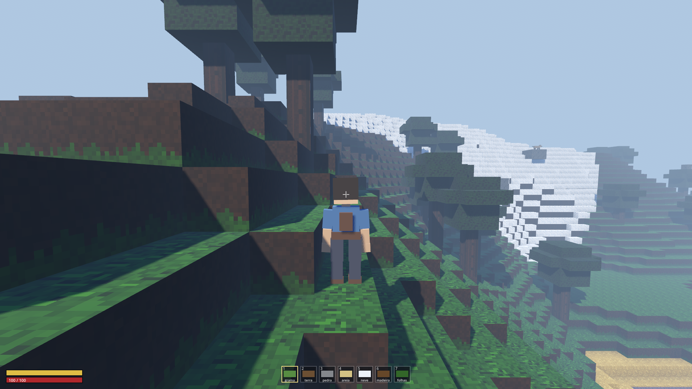
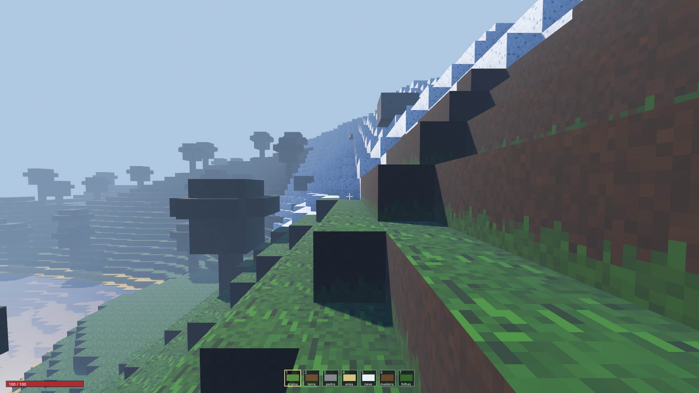
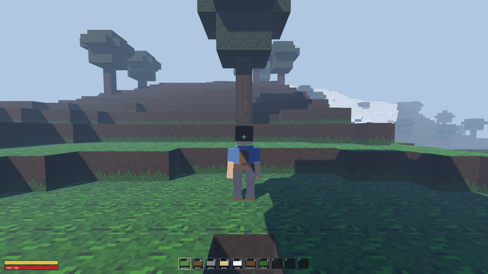
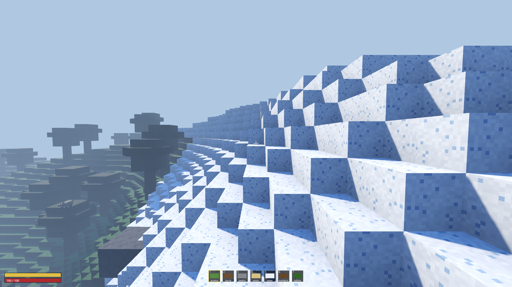

# Aetherfall

RPG open-world em voxels, feito em **Godot 4.7** com **GDScript**, sob licença
**MIT**. O diferencial do projeto é a IA dos moradores do mundo rodar 100% na
máquina do jogador: comportamento de criaturas, personalidade e memória de NPCs,
facções e eventos nascem de simulação local, sem serviço de nuvem.

Este repositório contém o **slice P0/P1**: um mundo procedural jogável em 3D,
com mecânicas de quebra/colocação, combate, memória do mundo (campo de Éter) e
lobos guiados por Behavior Tree + Utilidade + memória. O design completo do jogo
está em [`docs/design/`](docs/design/).

## O mundo

Todos os frames abaixo saíram do próprio RenderingServer do jogo rodando em
janela, 1920×1080, na seed padrão `20261116` — sem captura de desktop, sem
mockup, sem render de outra engine.

<table>
  <tr>
    <td width="50%"></td>
    <td width="50%"></td>
  </tr>
  <tr>
    <th>Planície, 3ª pessoa</th>
    <th>Planície, 1ª pessoa</th>
  </tr>
  <tr>
    <td></td>
    <td></td>
  </tr>
  <tr>
    <th>Orla de mata — o dossel a poucos blocos</th>
    <th>Lago e praia de areia no <code>SEA_LEVEL 26</code></th>
  </tr>
  <tr>
    <td></td>
    <td></td>
  </tr>
  <tr>
    <th>Monte nevado, 3ª pessoa</th>
    <th>Mirante: a neve descendo até o vale</th>
  </tr>
  <tr>
    <td></td>
    <td></td>
  </tr>
  <tr>
    <th>Minerando — a barra é progresso real, só existe lavrando</th>
    <th>Construção — muro 5×2 de pedra, bloco por bloco pelo clique direito</th>
  </tr>
  <tr>
    <td></td>
    <td></td>
  </tr>
  <tr>
    <th>Salto no ápice — 1,33 m de elevação medida</th>
    <th>Lobo sob a mira, com a intenção da mente no rótulo do alvo</th>
  </tr>
  <tr>
    <td colspan="2"></td>
  </tr>
  <tr>
    <th colspan="2">Visão do Éter (<code>B</code>) — o mapa de calor da memória do mundo; aqui o canal de trabalho, aceso por lavrar blocos. Sangue e medo entram quando um lobo faz parte da cena</th>
  </tr>
</table>

## Rodando a partir do clone

Pré-requisito único: **Godot 4.7** (o padrão serve; não há C#, não há addons, não
há assets para baixar). As medições deste README foram feitas no
**4.7.2-stable** com Vulkan Forward+. Renderiza em qualquer GPU com Vulkan 1.0.

```sh
git clone https://github.com/DouglasGDev/aetherfall.git
cd aetherfall
godot --headless --path . --import   # UMA VEZ: monta o .godot/ e o cache de classes
godot --path .                       # Linux/macOS
# Windows: .\Godot_v4.7.2-stable_win64.exe --path .
```

Esse `--import` não é burocracia: acabado de clonar, o projeto não tem `.godot/`
e por isso não tem o registro dos `class_name`. Pular a linha faz o run abrir
com `Could not find type "VoxelWorld" in the current scope` em tudo que depende
de `src/world/` — reproduzido aqui num clone limpo, e some depois do import. Se
você abrir o `project.godot` no editor em vez de usar a linha de comando, o
próprio editor faz o import e o passo acima é desnecessário.

Ou, pelo editor: **Importar** → selecionar `project.godot` → **F5**. Não há build
step nem `npm install` da vida: atlas e texturas são desenhados em runtime — os
PNG de `docs/media/` são capturas de tela, não assets do jogo.

O primeiro boot gera o mundo e malha os 64 chunks antes de entregar o controle ao
jogador: ~0,9 s de geração e ~4,3 s de malharia nesta máquina (medido; veja
*Limites*). O save vai para `user://saves/world_alpha.json` — no Windows,
`%APPDATA%\Godot\app_userdata\Aetherfall\saves\`. `F5` salva, `F9` carrega.

Um save antigo é recusado de propósito quando o gerador muda (`GEN_VERSION`): a
mensagem manda recriar o mundo em vez de interpretar mal o relevo.

## Controles

| Tecla | Ação |
| --- | --- |
| `W` `A` `S` `D` | mover |
| `Espaço` | pular |
| `Shift` | correr (consome vigor) |
| `Ctrl` | agachar / planar segurando no ar |
| Botão esquerdo | minerar bloco / atacar criatura |
| Botão do meio | rolamento (invencibilidade breve, custa vigor) |
| Botão direito | colocar bloco do slot selecionado |
| `1`–`7` | slot do hotbar |
| `V` | câmera em 1ª / 3ª pessoa |
| `B` | visão do Éter (mapa de calor dos canais) |
| `F3` | HUD de debug |
| `F2` | lista de bindagens |
| `F5` / `F9` | salvar / carregar o slot `alpha` |
| `Esc` | liberar o cursor |
| `R` | renascer (só com o jogador morto) |

## Teste headless

A suíte roda a sessão real (`src/main.tscn`) sem janela e só conta como prova o
que foi medido naquela execução:

```sh
godot --headless --path . --import            # só no clone ainda não importado
godot --headless --path . tests/smoke_test.tscn
```

Sai com código `1` se qualquer checagem falhar. Resultado da última execução
nesta máquina: **158 checagens, 0 falhas, 35,7 s** — e no clone limpo, depois
do import: **158 checagens, 0 falhas**. O que ela cobre:

- geração determinística (16 colunas de relevo e malha idênticas entre dois
  mundos criados com a mesma seed), face-culling exato (cubo 3×3×3 soma
  exatamente 108 triângulos; sem culling seriam 324) e winding dos triângulos
  na convenção de face frontal do Godot — com o índice em (0,1,2) o
  rasterizador descartava todas as faces de topo e o terreno aparecia
  transparente;
- relógio de simulação: 60 Hz de locomoção contra 20 Hz de lógica, teto de 5
  passos por frame, nenhum tick perdido durante o teste inteiro;
- mecânicas: mineração com o tempo igual à dureza do bloco, colocação por
  clique real do mouse passando pelo InputMap, recusa de colocar dentro do
  próprio corpo, construção com o botão esquerdo ainda pressionado (lavar um
  bloco não engole o clique direito), troca de hotbar por tecla;
- mecânicas do Veloren adaptadas: golpe com dano fixo que atordoa (steering
  suspenso) e empurra o lobo, vigor que a corrida drena e parar recupera com
  trava por histerese, rolamento no botão do meio com janela de invencibilidade
  de 0,45 s, planar segurando `Ctrl` no ar (mergulhar o olhar ganha velocidade,
  cap de queda medido no próprio ângulo), queda livre que machuca acima da
  velocidade segura, respiração com afogamento por período e regeneração fora
  de combate;
- IA local opcional (oráculo): com a porta do llama-server fechada, o pedido
  estoura o timeout, o oráculo entra em recuo (30 s medidos) e a narrativa no
  debug fica vazia — utilidade e árvore seguem decidindo sozinhas;
- sistema de coordenadas canônico (`Coords`): piso de negativos, bordas de
  chunk (15/16), ida e volta origem+local, chave de save com negativo e a grade
  grossa do Éter (4×4×4) saem todos do mesmo módulo;
- corpo do jogador em 3ª pessoa: 23 caixas montadas em pivôs, coladas nos pés,
  girando com o yaw, com a cabeça fora de cena na 1ª pessoa;
- IA: a mesma memória (`Mind`) muda a decisão do lobo entre os braços com e sem
  episódios gravados, e a fuga aparece depois de levar dano;
- campo de Éter: imprint, difusão para a célula vizinha e meia-vida por canal;
- HUD, morte e renascer, ciclo de vida dos lobos (cadáver, recolhimento e
  reposição de matilha);
- persistência: salvar → mutar o mundo → carregar devolve relevo, diário de
  edições, posição, vida, tick e a memória dos lobos.

## Estrutura

```
src/
  ai/            behavior tree, curvas de resposta, utilidade, mente do NPC, oráculo
  core/          relógio de simulação (20 Hz)
  entities/      jogador, corpo voxel (colisão AABB-contra-voxel), lobo
  input/         registro de ações (sai para rebinder com persistência no P2)
  persistence/   save atômico (.tmp + rename), schema e diário de edições
  rendering/     visão do Éter
  ui/            HUD, debug, mensagens
  world/         mundo voxel, chunks, gerador, blocos, atlas, campo de Éter,
                 conversões canônicas (Coords)
  main.gd        composição do slice
tests/           smoke test headless
tools/           fetch de packs de IA local + servidor do oráculo (PowerShell)
docs/design/     design completo (pitch, IA, progressão, arquitetura, roadmap)
```

## IA local (opcional)

A linha `ia:` no debug (F3) narra o estado interno do lobo sob a mira em uma
frase gerada por um modelo local. Sem o servidor o jogo roda completo — a
narrativa fica vazia e a utilidade/árvore decidem sempre sozinhas. O modelo
nunca decide: só explica o que já foi decidido (docs/design/04, camada 5).

```sh
powershell -ExecutionPolicy Bypass -File tools\fetch_models.ps1    # baixa runtime + mind-small com SHA256 conferido
powershell -ExecutionPolicy Bypass -File tools\run_mind_server.ps1 # sobe llama-server em 127.0.0.1:8741
godot --headless --path . tests/live_oracle_probe.tscn             # probe de ponta a ponta: sessao real + servidor
```

Medido na 9060 XT (Vulkan): boot do modelo em 9,5 s; prompt 52,7 tok/s e
geração 45,1 tok/s; a primeira frase do lobo aparece ~1,4 s depois do mundo
carregado e a segunda ~0,7 s depois (round-robin pela matilha).

Os pacotes ficam fora do repositório (`models/` e `.tools/` no `.gitignore`);
licenças e origens em [THIRD_PARTY_LICENSES.md](THIRD_PARTY_LICENSES.md):
Qwen3.5-4B Q4_K_M (Apache-2.0, 2,55 GB, quantização unsloth) e llama.cpp
b12499 Vulkan (MIT).

## O que existe e o que é alvo de design

Implementado neste repositório: mundo voxel procedural (relevo com planície,
lago e praia de areia no nível do mar — 12,5% das colunas caem abaixo de
`SEA_LEVEL 26` na seed padrão, monte nevado, árvores, blocos de pedra,
cavernas e túneis por ruído), malha com face-culling e oclusão ambiental por
vértice, texturas geradas em runtime (atlas 8×8), jogador em 1ª/3ª pessoa com
corpo animado (andar, agachar, pular, minerar, socar, planar, rolar, morrer),
quebrar e colocar blocos, combate corpo a corpo com vigor, rolamento e
planar, respiração e dano de queda, vida/dano/morte/renascer,
hotbar, HUD, 5 lobos com Behavior Tree + Utilidade + memória episódica e
confiança no jogador, campo de Éter com 3 canais (work, blood, fear) que difunde
e decai, relógio de simulação desacoplado, save/load atômico, o oráculo de IA
local opcional (llama-server + Qwen3.5-4B em localhost, narração no debug) e a
suíte headless acima.

Ainda **alvo de design** (descrito em `docs/design/`, sem código aqui): NPCs de
aldeia com objetivos próprios, facções e evolução de assentamentos, progressão
não linear com bosses reimaginados, crafting, matchmaking e co-op 1–4, e o
rebinder com persistência de bindagens. Nada disso está pronto — o slice é o
P0/P1 do roadmap.

## Limites conhecidos (medidos nesta máquina)

- Boot: ~0,9 s de geração + ~4,3 s de malharia dos 64 chunks (214.480
  triângulos), com a janela congelada. Os ~16 s originais caíram para ~7,5 s
  quando as consultas de vizinhança do mesher passaram a ler uma cópia linear
  do mundo em vez do dicionário de chunks; a medição acima é do relevo atual
  (`GEN_VERSION` 4), que escava cavernas e alaga cubas e portanto tem menos
  faces sólidas por chunk.
- Mundo fixo em 128×64×128 (8×8 chunks de 16×64×16), sem streaming de chunks.
- Uma criatura (lobo) e um NPC conceitual: a memória existe, mas não há
  aldeia nem facções.
- Single-player. O código separa o passo local do passo de simulação para
  permitir o dedicado, mas não há rede implementada.

## Contribuindo

O projeto é aberto e a fatia atual é pequena de propósito: dá para ler o inteiro
em uma tarde. Comece pelo [design](docs/design/README.md) — os documentos usam a
legenda `[TARGET]` / `[MEASURED]` / `[DECIDED]` / `[OPEN]`, e nada aqui promete
número que não tenha sido medido.

### Mapa do código

| Caminho | O que faz |
| --- | --- |
| `src/main.gd` | composição da cena: mundo, jogador, lobos, Éter, HUD, save |
| `src/world/` | `voxel_world` (chunks + raycast DDA), `world_gen` (relevo, cubas, cavernas, árvores), `voxel_atlas` (texturas desenhadas em runtime), `aether_field` |
| `src/entities/` | `player` (mira, minerar, colocar, golpe), `voxel_body` (colisão AABB-contra-voxel), `player_avatar` (corpo em 3ª pessoa), `wolf` |
| `src/ai/` | `bt_tree`/`bt_status` (Behavior Tree), `response_curve` + `utility_scorer` (utilidade), `mind` (personalidade, memória episódica, confiança) |
| `src/core/sim_clock.gd` | relógio de simulação a 20 Hz, desacoplado do frame |
| `src/persistence/` | `save_manager` (escrita atômica: `.tmp` + rename, schema versionado) |
| `src/ui/`, `src/rendering/`, `src/input/` | HUD, visão do Éter, registro de ações |
| `tests/smoke_test.gd` | a suíte headless que roda a sessão real |

### Regras que o código já segue

- **GDScript tipado, sem C# e sem addons.** `class_name` PascalCase, um por
  arquivo, arquivo `snake_case` ASCII puro (a convenção completa está em
  [`docs/design/07`](docs/design/07-project-structure.md)).
- **Dependência só desce.** Nada em `src/world/` ou `src/ai/` referencia
  `src/ui/`: HUD e rede são *consumidores de eventos*, nunca produtores de
  estado. É isso que mantém o `--headless` funcionando e o dedicado idêntico ao
  host de um jogador.
- **Determinismo em primeiro lugar.** Ruído e RNG derivam da seed do mundo;
  features escrevem só dentro do chunk de origem (`FEATURE_INSET 3`), para que a
  ordem de geração dos vizinhos não mude o resultado. Mudou o gerador, suba
  `GEN_VERSION` — o save antigo é recusado com mensagem em vez de ser lido torto.
- **Segurar botão se mede em tick de física, não em frame.** Os cooldowns de
  colocar (0,16 s) e golpear (0,42 s) decaem em `player.update_local()`, chamada
  por `_physics_process`; nesta máquina o render mede ~163 fps contra ~60 Hz de
  física (2,7× de diferença), então cronometrar uma ação segurada contando
  `_process` conta o relógio errado e o teste passa por sorte.
- **Nada de número sem medição.** PR que afirma custo, taxa ou tempo traz o
  comando e a revisão em que rodou.

### Gates antes de abrir o PR

```sh
# porta de compilação por arquivo alterado (roda em segundos)
godot --headless --path . --check-only --script res://src/world/world_gen.gd
# suíte completa: ~28 s, sai com código 1 em qualquer falha
godot --headless --path . tests/smoke_test.tscn
```

Ambos assumem o projeto já importado (`.godot/` existe) — num clone recém-feito,
rode o `--import` da seção *Rodando a partir do clone* primeiro.

### Onde há trabalho aberto de verdade

Coisas que faltam e que dá para atacar hoje, cada uma com o critério de "pronto"
medível no `--headless`:

- **Bloco que emite luz.** As cavernas existem (`CAVE_THRESHOLD 0.80`,
  `CAVE_MIN_DEPTH 12`) mas nenhum dos 8 blocos é emissivo — dentro de uma
  cavidade a luminância medida do quadro é ~0,15, ou seja, não há o que mostrar.
- **Bioma deserto.** `SAND` abaixo de `SEA_LEVEL` vira praia; acima dele a
  varredura da seed padrão conta **0** colunas. Falta o clima, não a areia.
- **Streaming de chunks.** O mundo é fixo em 128×64×128; o mesher já tem índice
  linear, então o corte é por região.
- **Rebinder com persistência.** `src/input/input_actions.gd` grava as teclas no
  código; a estrutura de ações já é a que permite rebinding.
- **Mais espécies.** A máquina de IA (`src/ai/`) é genérica — só existe lobo. Uma
  segunda espécie é o teste real de que o `Mind` não é específico de um bicho.
- **Co-op 1–4.** O passo de simulação já separado do passo local é o gancho.

Dúvida de arquitetura antes de escrever código? Abra uma issue apontando o
documento de design: é mais barato do que refazer o PR.

## Licença

MIT — veja [`LICENSE`](LICENSE).
